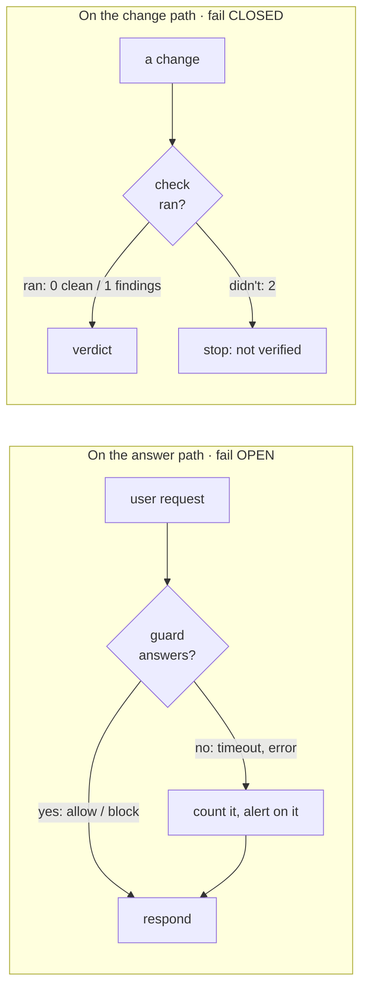
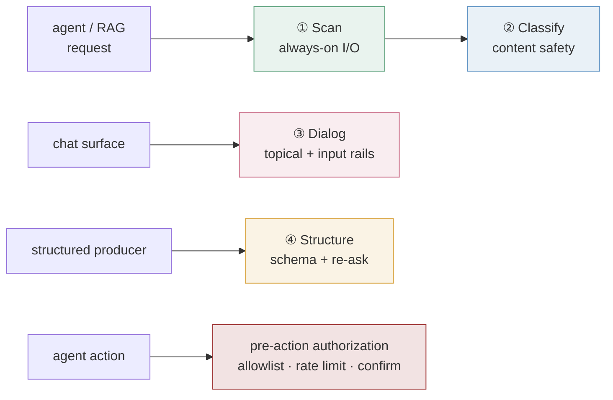

<p align="center">
  <picture>
    <source media="(prefers-color-scheme: dark)" srcset="assets/logo-dark.svg">
    
  </picture>
</p>

<h3 align="center">Grrrr, don't forget the guardrails!</h3>

<p align="center">
  <a href="https://github.com/edtbl76/grkit/actions/workflows/ci.yml"></a>
  <a href="LICENSE"></a>
  
</p>

---

grkit is a small kit for people who put LLMs into real software. It does two jobs:

1. **It keeps the model in its lane while it's serving.** A tiny Python library for talking to guard services:
   prompt-injection scanners, PII detectors, safety classifiers, action allowlists. It never lets a broken guard
   take your product down.
2. **It keeps your changes honest before they ship.** A project template that drops sensible rules for your
   coding agents (and your humans) into any repo, plus a pattern for writing checks that can't quietly pass when
   they didn't actually check anything.

It has no dependencies, ships no models, and runs no servers. It's the rules, the contracts, and a little code that
makes the rules easy to follow.

## Why it exists

grkit was pulled out of [weyland](https://github.com/edtbl76/weyland-lab), a self-hosted AI platform run by one
person and a lot of coding agents. Over a few months, the same kind of bug kept showing up in different places:

- A PII detector flagged the word **"Traefik"** as a person's name, with 100% confidence.
- A code-quality gate reported **"passed"** on a brand-new project with a critical issue wide open.
- A heartbeat monitor went **red one minute after every successful run**, because its interval was the default
  60 seconds and the job ran once a day.
- A backup had run every night for months and **had never once been restored**.
- A test written to prove a check fails closed **passed before the check even existed**: it only asserted "exit
  code is not zero", and "command not found" is not zero either.

Every one of these is the same mistake: **something that didn't happen looked exactly like something that went
fine.** grkit is what's left after fixing that mistake enough times to write it down.

## The one idea

Guardrails live in two places, and when the guardrail itself breaks, they should fail in **opposite** directions.



- **Serving a user?** A guard that's down must not take your product down with it. Treat it as "not guarded" and
  keep answering, but **count every time that happens**, so a guard that quietly stopped guarding still pages
  somebody. (One exception: checks on *authority*, like "may this caller run this action?", fail closed even here.
  No trusted identity, no action.)
- **Shipping a change?** A check that couldn't run must never look like a pass. "I verified nothing" and "I
  verified, and it's fine" are different answers, and your CI should treat them differently.

Both rules are the same rule: **never let an absence pose as a result.** The long version is
[docs/method.md](docs/method.md).

## The runtime half: the guardrails platform

No single guardrail catches everything. A prompt-injection scanner has no idea whether an answer stayed on topic, a
topic filter has no idea whether a JSON blob matches its schema, and neither one classifies content safety the way
a model trained for it does. So grkit's runtime half is built around **four paths, each doing one job**, composed as
defense in depth:

| # | Path | Reference tool | The one job it does | Where it sits |
|---|---|---|---|---|
| ① | **Scan** | Prompt Guard · Presidio · an NLI model | fast input/output checks: injection, PII, grounding, action policy | always on, at the agent's edge and the tool gateway |
| ② | **Classify** | Llama Guard | content safety, by category | a second opinion Scan calls: small model on CPU, bigger one on GPU when it matters |
| ③ | **Dialog** | NeMo Guardrails | keep a conversation on topic, resist jailbreaks | only the chat surface |
| ④ | **Structure** | Guardrails AI | validate structured output, re-ask the model to fix it | only producers of structured output |



Each guard runs only where it earns its keep, not every layer on every request. Two lanes complete the picture:
**pre-action authorization**, which decides who may do what and *fails closed* (no trusted identity, no action),
and **offline evaluation**, an LLM-judge lane that grades faithfulness away from live traffic.

The tools are the ones this kit was built and measured against, not requirements. Swap any of them, but keep the
jobs separate: each covers a failure the others can't see. Why four and not one, and the honest engineering notes
(why the heavy ones end up as separate services, why the plain primitive beat the clever one), are in
[docs/runtime-guardrails.md](docs/runtime-guardrails.md).

What the Python package gives you is the **contract between them and your code**, built on two rules:

- **New guards start in shadow mode.** They score everything and record it, but block nothing. You promote a
  guard to blocking only after you've measured how often it's wrong on your real traffic.
- **Callers fail open on content, closed on authority, and loudly either way.** If the guard is unreachable, a
  prompt or an answer goes through unscanned, but an *action* is refused. Every failure is counted by cause.

```python
from grkit.client import GuardClient
from grkit.verdict import Hook

guard = GuardClient("http://guard:8080", timeout=10,
                    on_failure=lambda hook, cause: GUARD_FAILOPEN.labels(hook.value, cause).inc())

blocked = guard.guard(Hook.OUTPUT, request_id, {"answer": answer, "sources": sources}, actor=caller)
if blocked:
    return refuse(blocked.reason)
```

The full contract (routes, modes, how to promote a guard, and calibration notes such as why a PII detector is
useless on infrastructure docs) is in [docs/runtime-guardrails.md](docs/runtime-guardrails.md).

## The build-time half: guarding the change

Every check in a grkit project speaks the same three exit codes:

| Exit | Means |
|---|---|
| `0` | It ran, and it found nothing. |
| `1` | It ran, and here's what's wrong (every finding is named). |
| `2` | **It couldn't run.** No input, a crash, nothing to check. Never a pass. |

The Copier template sets a repo up to work this way:

```
pipx run copier copy gh:edtbl76/grkit path/to/your/repo
```

You get an `AGENTS.md` with the core rules your coding agents should follow, a nine-pillar definition of done,
and a worked example guard (`check-required-docs.sh`) with tests that watch it fail every way it should. When the
kit learns a new lesson, `copier update` brings it to your repo as a normal diff you can review.

More in [docs/change-gate.md](docs/change-gate.md).

## Quick start

```
# the runtime library (stdlib only, Python 3.10+)
pip install "grkit @ git+https://github.com/edtbl76/grkit@v0.2.0#subdirectory=python"

# the project template
pipx run copier copy gh:edtbl76/grkit path/to/your/repo
```

Step by step, with what each piece is for: [docs/adopting.md](docs/adopting.md).

## What's in the box

| Path | What it is |
|---|---|
| [`docs/`](docs) | The method, the runtime contract, the change gate, and how to adopt each half |
| [`python/`](python) | The `grkit` package: `verdict`, `client`, `modes`, `pipeline`, `checks` |
| [`template/`](template) | The Copier template: `AGENTS.md`, the definition of done, an example guard and its tests |
| [`scripts/test.sh`](scripts/test.sh) | Everything we test, run in Docker as you (nothing installed on your machine) |

## What it isn't

- **Not a guard service.** grkit doesn't scan anything itself; it's the contract and the client. Run whatever
  guard models suit you.
- **Not a framework.** Five small modules and a template. Read them in an afternoon.
- **Not finished.** It's version 0.1. The rules come from one platform's mistakes; your mistakes are welcome too.

## Contributing

Bug reports, war stories and pull requests are all welcome. Start with [CONTRIBUTING.md](CONTRIBUTING.md). The
short version: write the failing test first, make it assert *why* something failed, and run `bash scripts/test.sh`
before you open the PR.

## License

[MIT](LICENSE).
