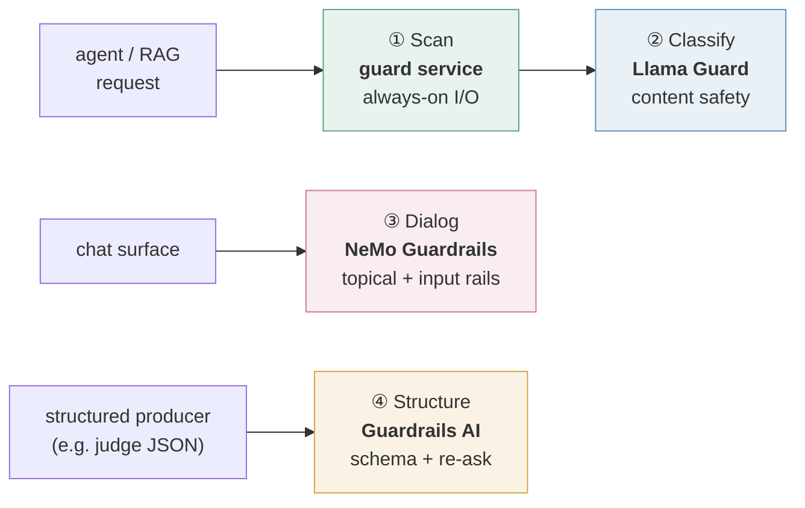

# The guardrails platform: four paths, defense in depth

No single guardrail catches everything. A prompt-injection scanner says nothing about whether an answer is
*on topic*; a topical rail says nothing about whether a JSON blob *matches its schema*; and none of them classify
*content safety* the way a model trained for it does. So run **four complementary tools, each doing one job**,
composed as defense in depth. They don't compete; each covers a failure the others can't see.

Every tool named below is open source and self-hostable. They're the references this kit was built and measured
against, not requirements: swap any of them, but keep the four jobs separate.

## The four paths

| # | Path | Reference tool | The one job it does | Where it sits |
|---|---|---|---|---|
| ① | **Scan** | a guard service running Prompt Guard · Presidio · an NLI cross-encoder | fast **input/output sanitisation**: injection, PII, grounding, action policy | the always-on first layer, at the agent's edge and at the tool gateway |
| ② | **Classify** | **Llama Guard** | model-based **content-safety classification**: safe / unsafe, plus the category | a classifier the Scan layer calls: a **small model on CPU** by default, a **larger one on GPU** on demand |
| ③ | **Dialog** | **NeMo Guardrails** | **topical / conversational** control: keep the assistant in scope, resist jailbreaks | only the conversational surface, as a dedicated guarded chat model |
| ④ | **Structure** | **Guardrails AI** | **output-schema validation**: validate, and **re-ask** the model to repair | only producers of structured output (for example an LLM judge's JSON) |

## How they compose

Each guard runs on the surface where it earns its keep, not every layer on every request.

- **① Scan** is the always-on baseline every agent request passes through. In SHADOW it scores off the request
  path, so it adds almost no latency.
- **② Classify** is the model-based second opinion Scan can call. The small model answers by default; the larger
  one is started only when a heavier verdict is wanted.
- **③ Dialog** wraps only the **conversational** surface: a dedicated guarded chat model, so general chat stays
  unguarded and unslowed.
- **④ Structure** wraps only **structured-output** producers, where a malformed blob would silently break whatever
  reads it.

Two more lanes complete the picture:

- **Pre-action authorization** (the act hook): an enforcing allowlist and rate limit per caller, plus a human
  confirm step for anything that changes state. Unlike the four paths, this one **fails closed**: an action with no
  trusted caller identity is refused. It decides authority, not content.
- **Offline evaluation**: an LLM-judge lane that scores faithfulness and quality against a golden set, off the
  request path. That's where real truth gating lives; the online grounding check stays advisory.

## Why four tools, not one

Each path covers a distinct failure mode a single tool can't:

- **① Scan** stops the input and output attacks and leaks (injection, PII). It's fast enough for every request.
- **② Classify** catches content-policy violations a keyword or embedding scanner misses (weapons, self-harm,
  harassment) with a model trained for exactly that, and grades them by category. Tiers matter: on the same
  request, a 1B Llama Guard said "violent crime" where the 8B said "weapons". The sharper call is why the stronger
  tier exists.
- **③ Dialog** keeps a *conversation* in scope, which stateless I/O scanners have no notion of.
- **④ Structure** guarantees a machine-readable contract: valid JSON matching a schema, regenerated on failure, so a
  producer's output can't silently corrupt its consumer.

## Engineering realities (the honest part)

- **Fail open, everywhere on the content paths.** Every guard degrades to "not guarded", never "no answer"; a guard
  outage must never take a response offline. Verdicts ship in **SHADOW** first; you measure the false-positive rate
  on real traffic before promoting anything to blocking.
- **Dependency isolation forces services.** Classify, Structure and Dialog each run as their own service, not
  in-process: Guardrails AI and NeMo Guardrails pin libraries that most application stacks can't share. The tools'
  dependency politics decide the architecture as much as any design argument.
- **The reliable primitive beats the elegant one.** NeMo's signature topical flows may simply not fire. A single
  LLM-judged input rail that checks both jailbreak and off-topic does, and a custom refusal message keeps the user
  experience identical. When an elegant primitive won't cooperate after honest attempts, switch to the plainer one
  that works.

## The guard service contract

A guard service exposes one typed route per hook, so each hook can require its own fields:

| Route | Body | Typical validators |
|---|---|---|
| `POST /guard/input` | `{request_id, query, actor?}` | injection, content safety |
| `POST /guard/output` | `{request_id, answer, sources: [{content}], actor?}` | PII, grounding (needs the sources), content safety |
| `POST /guard/act` | `{request_id, tool, params?, actor?}` | an audit record, an enforcing allowlist / rate limit |
| `GET /ready` | — | 503 until the validator set is loaded |
| `GET /metrics` | — | verdicts by validator and decision, validator latency |

Response: `{request_id, decision: "allow" | "block", verdict: {validator, decision, score, reason, latency_ms} | null}`.
The vocabulary is `grkit.verdict`: `Decision` (pass · flag · block), `Hook` (input · output · act),
`Mode` (off · shadow · flag · block).

## The two promises that make it safe

- **SHADOW is fast.** In SHADOW the service answers `allow` at once and scores in the background, so a caller's
  synchronous call costs a network round trip, not model inference (`grkit.pipeline.GuardrailPipeline`). The
  caller never needs to know the mode: it stops the request if and only if the service says `block`.
- **Callers fail open on content, closed on authority.** Unreachable, timed out, an HTTP error, an unreadable
  answer: on the input and output hooks the caller treats it as `allow`; on the act hook it refuses the action
  (`guard-unavailable`). Either way it counts it (`grkit.client.GuardClient`). Verify both by scaling the guard to
  zero: the product must keep answering, actions must be refused, and the failure counter must rise.

## Modes and promotion

Every validator ships in SHADOW. A per-validator setting (`GUARDRAIL_MODE__<name>`, dots as double underscores)
changes it; an invalid value stops the service at startup (`grkit.modes.ModeTable`). A live override for a demo is
in-process only, so a restart returns to the committed modes and nothing is left "on" by accident; gate it with an
admin token that fails closed when unset.

Promote a validator to FLAG, then BLOCK, only with a measured false-positive rate on the traffic it will see.

## Calibration lessons worth keeping

- **PII on technical text:** NER labels tool names as `PERSON` with full confidence, and markdown spans as crypto
  addresses. A threshold does not help at that confidence; the lever is the entity set. Keep the regex-backed
  entities (email, phone, card numbers) as the solid core, and context-gate `PERSON` to data that actually
  carries people's names. Drop IP addresses and UUIDs on infrastructure text: every one fires.
- **Grounding measures attributability, not truth.** A sentence-level NLI score says whether an answer can be
  traced to the retrieved chunks. Correct answers that synthesise beyond sparse chunks score low. Keep it advisory;
  gate faithfulness with an LLM judge instead.
- **Bound model work inside the service.** Cap and serialise expensive scoring (claims per answer, batch size, a
  lock): an unbounded scorer will exhaust the service's memory before it blocks anything.
- **Identity comes from a trusted hop.** The `actor` on an ACT call must be injected by an authenticating gateway,
  never read from the client's own claim. An enforcing action policy blocks a call with no actor.
- **Record every verdict durably** (a table, not only metrics). It is the evidence for every promotion decision.
